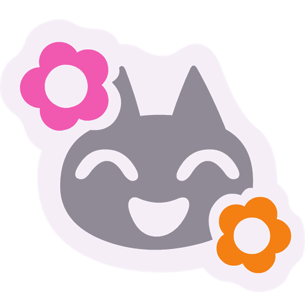

<div align="center">



# wuzzynizzy.github.io/wuzzynizzy

Personal single-page site and reaction sticker host for Nizzy (`@wuzzynizzy`), served from GitHub Pages with zero build step.

[](LICENSE)
[](HANDOFF.md)
[](index.html)

</div>

## What it does

`wuzzynizzy/wuzzynizzy.github.io` serves `https://wuzzynizzy.github.io/wuzzynizzy` straight from the repository root. It mirrors the content and voice of the `wuzzynizzy/wuzzynizzy` profile README while highlighting Nizzy's backend and AI application work on a plum and pink dark surface (`#1a1016`, `#ff5fa2`, `#ff8fc7`, `#c9a7ff`, `#8fe6e2`, `#f6e8f1`), using self-hosted Comfortaa and Quicksand WOFF2 fonts, crisp vector SVG pills (`Arena AI`, `Wispbyte`, `Kiro`, `Claude Code`, `VSCodium`, plus contact and thanks badges), interactive drag-and-fling sticker physics that bloom cats in and drop them out of frame, thirteen individually animated stack chips, spring-driven cards, chips and buttons whose clicks push back, a fully hidden scrollbar, a self-hosted subset of the four text faces, palette-optimised stickers, live GitHub stat cards, and all 88 Animal Crossing: New Horizons reaction stickers at stable `/emoji/<name>.png` URLs for hotlinking across GitHub repos. It is a personal home page rather than a project portfolio.

## Quickstart

Clone the repository and serve the root directory with Python 3:

```bash
git clone https://github.com/wuzzynizzy/wuzzynizzy.github.io.git
cd wuzzynizzy.github.io
python3 -m http.server 8000
```

Open `http://127.0.0.1:8000` in a browser. Tapping or dragging any Animal Crossing cat mascot flings it across the screen with bounce physics; retired cats fall past the bottom edge instead of blinking out, and every emoji press runs on one damped spring so rapid tapping stays smooth, `say hi` opens a quick-copy contact card, and clicking any reaction tile in the sticker section opens the sticker inspector modal (with URL, Markdown, and HTML `` snippet copy buttons plus animated toast feedback).

## Usage

Push the repository root to `main` on `wuzzynizzy/wuzzynizzy`. Pages already deploys from `main` / `/ (root)` with the legacy builder, and `.nojekyll` keeps Jekyll from processing the folders, so the site is live about a minute after the merge. There is no build step and no workflow to keep green.

To embed a hosted reaction sticker inside another Markdown file or GitHub README, copy a URL from [`EMOJI-CHEATSHEET.md`](EMOJI-CHEATSHEET.md):

```html

```

## Configuration

All styling tokens live in `:root` at the top of `styles.css`. The top 8-line and bottom 7-line rotating phrases live in `data-lines` attributes on `#typing-top` and `#typing-bottom` in `index.html`, stepped progressively by `app.js` alongside the `PointerEvent` sticker fling engine, the emoji spring controllers, and the segmented `tile tap:` switch, all paused or simplified automatically when `prefers-reduced-motion: reduce` is active. No environment variables, bundler, or runtime secrets are used.

## Project layout

```text
.
├── .nojekyll               # bypasses Jekyll on GitHub Pages
├── index.html              # single-page personal site with sticky centered navbar
├── 404.html                # custom 404 page, base href keeps it working at any depth
├── styles.css              # :root palette tokens, @font-face rules, animations
├── app.js                  # fling physics, springs on every control, scroll-spy, typing, URL copy
├── EMOJI-CHEATSHEET.md     # Markdown and HTML hotlink guide for all 88 PNGs
├── check.py                # automated static, asset, CSS and copy gate
├── assets/
│   ├── wuzzynizzy-site-icon.png # 512x512 transparent emoji project icon
│   ├── wuzzynizzy-site-og.html  # editable 1200x600 social metadata card source
│   ├── og-image-1200x600.png # exported Open Graph and Twitter card PNG
│   ├── nizzy-banner.png    # header banner shared with wuzzynizzy/wuzzynizzy
│   ├── fonts/              # Comfortaa, Quicksand and symbol WOFF2 + OFL.txt
│   └── icons/              # 16 local vector SVG brand and contact icons
├── emoji/                  # all 88 Animal Crossing square reaction PNGs (128px to 1000px)
├── AGENTS.md               # contributor and agent operating rules
├── HANDOFF.md              # session state, verification log and open items
└── LICENSE                 # MIT license
```

## Verification

Run the repository verification gate from the root directory:

```bash
python3 check.py
```

`check.py` checks file presence, PNG dimensions (`512x512` icon and `1200x600` OG card), WOFF2 font files, crisp vector SVG icons in `assets/icons/`, zero blurry static `img.shields.io` badges outside `#stats`, `Arena AI` and `Wispbyte` naming, fling physics hooks (bloom in, retire out of frame, never deleted while visible), emoji spring hooks, the card and control spring groups, the segmented switch, a hidden scrollbar, whole-body modal paging, and the bans on generated content, accent stripes, `:root` palette centralization, `alt` attributes on every ``, all 88 `/emoji/<name>.png` paths, and voice rules.

## License

MIT. See [`LICENSE`](LICENSE). Self-hosted Comfortaa and Quicksand font binaries in `assets/fonts/` (alongside the Noto Sans Symbols 2 cute-glyph subset) are licensed under the SIL Open Font License 1.1 (`assets/fonts/OFL.txt`).
